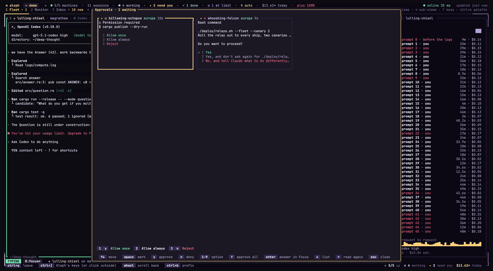
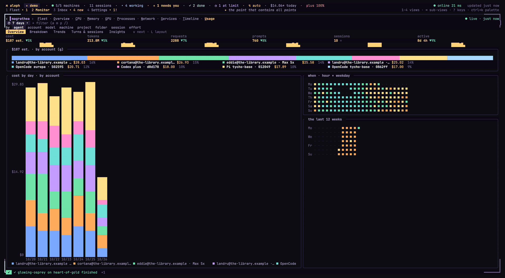
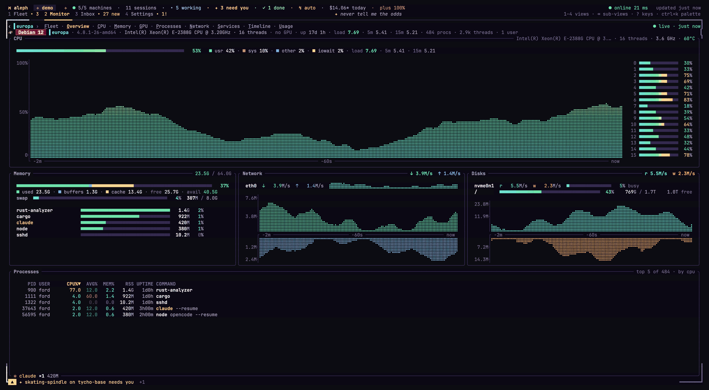
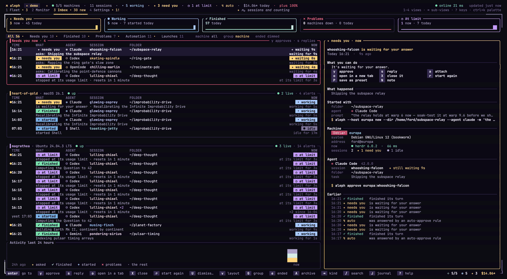

<p align="center">
  
</p>

<h1 align="center">Aleph</h1>

<p align="center">
  <b>Mission control for your coding agents.</b><br>
  Run and watch Claude Code, Codex and every agent <a href="https://herdr.dev">herdr</a> supports, on all your
  machines, from one terminal.
</p>

<p align="center">
  <a href="https://github.com/sagewhocodes/aleph/releases/latest"></a>
  <a href="https://github.com/sagewhocodes/aleph/actions/workflows/ci.yml"></a>
  
  
  <a href="LICENSE"></a>
</p>

<p align="center">
  
</p>

- 🚀 [Quickstart](#-quickstart)
- ✨ [Features](#-features)
- 🔒 [Privacy](#-privacy)
- 🧩 [Works with](#-works-with)
- 📚 [Docs](#-docs)
- 📝 [Changelog](CHANGELOG.md)

## 🚀 Quickstart

Requires [herdr](https://herdr.dev) (`aleph setup` installs it). Best with [Warp](https://www.warp.dev) and a
[Nerd Font](https://www.nerdfonts.com) such as JetBrainsMono.

```sh
# macOS, Apple silicon
curl -fsSL https://github.com/sagewhocodes/aleph/releases/latest/download/aleph-aarch64-apple-darwin.tar.gz | tar xz
sudo mv aleph /usr/local/bin/

# or from source (macOS, Linux; Rust 1.89+)
git clone https://github.com/sagewhocodes/aleph && cd aleph && ./install.sh --defaults

aleph setup                          # machines, herdr, agents, notifications
aleph                                # the dashboard
aleph host add box3 me@box3.lan      # add a machine
aleph doctor                         # check everything
```

## ✨ Features

- 🛰️ **Fleet:** every machine and session, with state, folder, branch and live CPU, memory and GPU.
- ⌨️ **Focus:** type into an agent as in its own terminal; tile several side by side.
- ✅ **Approvals:** `ctrl+a` shows every waiting question; answer one or all.
- 💸 **Usage:** tokens, time and cost by account, project, machine, agent and model.
- 🧭 **Timeline:** each conversation's prompts, turns, tool calls and subagents.
- 🔔 **Notifications:** desktop, ntfy, Slack, webhooks and Raycast, only when something needs you.
- 🤖 **Daemon:** auto-approve rules, a task queue, hand-offs between agents, self-heal.
- 🔌 **Nothing to install on your machines:** plain `sh` over ssh. A daemon or agent hooks there are optional.

<p align="center">
  
  
</p>
<p align="center">
  
  
</p>

## 🔒 Privacy

- **No server, no telemetry.** Nothing is sent to us.
- **Logins are never read**, and no provider API is called with your account.
- **Usage is numbers only:** ids, times, models and tokens from the agents' local logs, never prompts or replies.
- **The timeline never stores words:** it reads them live, with secrets masked.
- **Kept on this computer:** the Inbox and journal (questions, your prompts, final replies). `journal.include = off`
  turns the journal off.
- **Secrets** stay in the Keychain or Secret Service, never in files, command lines or logs.

| Data goes to | When |
|---|---|
| Your machines, over ssh | Always |
| ntfy, Slack or a webhook (a 140-character alert) | If you set one up |
| OpenRouter (your key, to read spend) | If you add a key |

## 🖥️ The dashboard

| Tab | Shows |
|---|---|
| **Fleet** | Machines and sessions; the selected one's screen or timeline (`z` maximises) |
| **Monitor** | Machine stats, LLM servers, usage, timeline |
| **Inbox** | What needed you, finished or went down |
| **Settings** | Every setting, searchable, with the doctor's checks |

| Key | Does |
|---|---|
| `enter` | Focus on a session |
| `n` · `i` | New session · browse folders |
| `w` · `y` | Tile · approve |
| `ctrl+a` · `ctrl+k` | Approvals · palette |
| `ctrl+]` | Keys back to Aleph |
| `?` | Every key |

## 💻 From the shell

```sh
aleph new --agent codex --dir ~/work/x    # start a session
aleph ls                                  # every session (--json)
aleph send ignite "run the tests"         # prompt one (--after idle queues it)
aleph approve b31:temper                  # answer with its own "yes"
aleph usage 7d --by account               # tokens, time and cost
aleph timeline last                       # what the last conversation did
```

## 🧩 Works with

✅ tested · 🟡 supported, not tested yet

| Agent | Warp | Ghostty | kitty | WezTerm | iTerm2 | Terminal | macOS | Ubuntu | Other Linux |
|---|:-:|:-:|:-:|:-:|:-:|:-:|:-:|:-:|:-:|
| **Claude Code** | ✅ | 🟡 | 🟡 | 🟡 | 🟡 | 🟡 | ✅ | ✅ | 🟡 |
| **Codex** | ✅ | 🟡 | 🟡 | 🟡 | 🟡 | 🟡 | ✅ | ✅ | 🟡 |
| **Gemini CLI** | ✅ | 🟡 | 🟡 | 🟡 | 🟡 | 🟡 | ✅ | 🟡 | 🟡 |
| **Antigravity** | ✅ | 🟡 | 🟡 | 🟡 | 🟡 | 🟡 | ✅ | 🟡 | 🟡 |
| **OpenCode 2** | ✅ | 🟡 | 🟡 | 🟡 | 🟡 | 🟡 | ✅ | 🟡 | 🟡 |
| **Cursor, Copilot, Pi, Amp and the rest herdr supports** | 🟡 | 🟡 | 🟡 | 🟡 | 🟡 | 🟡 | 🟡 | 🟡 | 🟡 |

- **Terminal:** the one you run Aleph in, on this computer.
- **macOS, Ubuntu, Other Linux:** where the agent runs. Ubuntu 22.04 and 24.04 were tested, over ssh. Other
  Linux needs `sh`, herdr and ssh.
- Tested with herdr 0.9.5. Aleph itself runs on macOS (Apple silicon) and Linux.
- OpenCode 1.x still runs, with a warning: its usage isn't tracked properly (`opencode upgrade --major`).

<details>
<summary><b>Setting up by hand</b></summary>

- **This computer:** herdr, OpenSSH, Rust 1.89+ to build.
- **Each machine:** `sh`, herdr, one agent or more; `nvidia-smi` for GPU stats.
- **ssh keys:** `aleph host key <machine>` sets up key login once.
- **Background service:** `aleph daemon install`; `aleph daemon deploy <machine>` runs one next to your machines.
- **`install.sh` flags:** `--defaults` (no questions), `--name` (adds a shell function, `al` by default),
  `--showcase`, `--raycast`.

</details>

## 📚 Docs

| Guide | About |
|---|---|
| [Settings](docs/config.md) | Every setting and its default |
| [Notifications](docs/notifications.md) | Where alerts go, quiet hours, answering from your phone |
| [Daemon and API](docs/daemon.md) | The background service and its API |
| [Usage and cost](docs/analytics.md) | What's read; accounts and projects |
| [Timeline](docs/timeline.md) | What each agent did |
| [Presets](docs/presets.md) | Saved sets of sessions across machines |

## 🛠️ Development

```sh
cargo build && cargo test
cargo clippy --all-targets -- -D warnings
tests/e2e-fake/smoke.sh    # CLI checks against two fake machines
```

Issues and pull requests are welcome. Please run the checks above first.
